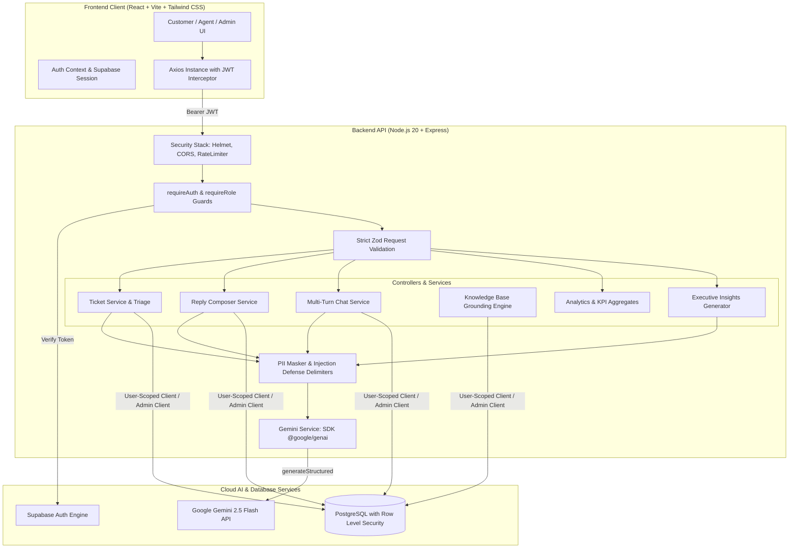

# CX Copilot — AI-Powered Customer Experience Platform

> Production-ready, omnichannel AI customer experience platform powered by Google Gemini 2.5 Flash, React 18, Node.js/Express, and PostgreSQL with Row Level Security (RLS).

---

## 1. Problem Statement & Solution

### The Challenge
Businesses struggle to maintain fast, personalized, and consistent customer support across growing channel volumes (Web, Live Chat, Email, Social). Key pain points include:
- Slow first response times and inconsistent agent tone across shifts.
- High churn-risk and escalated tickets getting buried in queues until it is too late.
- Support teams lack real-time factual grounding, leading to inaccurate answers or unauthorized refund promises.
- Leadership lacks structured, actionable visibility into *why* customers are frustrated across their customer journeys.

### The Solution: CX Copilot
CX Copilot unifies customer interactions from every touchpoint into one intelligent workspace:
1. **Instant AI Triage**: Analyzes each incoming interaction in under 10 seconds for sentiment (-1 to +1), intent, urgency (`low`, `medium`, `high`, `critical`), and churn risk (0–100%).
2. **Knowledge-Grounded Reply Drafting**: Generates brand-safe responses in 4 selectable tones (`empathetic`, `professional`, `friendly`, `concise`) grounded strictly in verified Knowledge Base articles.
3. **Human-in-the-Loop Safeguard**: Support agents can inspect AI reasoning, adjust text, and approve replies with one click before anything reaches the customer.
4. **Autonomous AI Support Assistant**: Persistent multi-turn chat assistant capable of detecting customer frustration and auto-escalating to human tickets.
5. **Customer 360° & Next-Best-Action Engine**: Recommends personalized retention and goodwill actions based on relationship health scores.
6. **Executive CX Insights**: Synthesizes thousands of tickets into root-cause hypotheses, emerging trends, and prioritized owner-assignable recommendations.

---

## 2. Architecture Diagram



---

## 3. Technology Stack

| Component | Technology | Rationale |
|---|---|---|
| **Frontend Framework** | React.js 18+ & Vite | Ultra-fast HMR, lightweight bundle size, and modern component architecture |
| **Routing** | React Router v6 | Nested layouts (`AppShell`), protected routes, and role-based route guards |
| **Styling** | Tailwind CSS & Custom Design System | High-end dark mode aesthetics, glassmorphism, responsive tokens |
| **Icons & Notifications** | Lucide React & React Hot Toast | Accessible, crisp icon library and real-time toast feedback |
| **Data Visualization** | Recharts | Responsive SVG charts for sentiment trends, urgency donuts, and channel mix |
| **Backend Framework** | Node.js 20+ with Express.js | High-throughput asynchronous runtime with modular ES module architecture |
| **Database** | PostgreSQL via Supabase | Relational data integrity, ACID compliance, and fine-grained Row Level Security |
| **Authentication** | Supabase Auth | Secure bcrypt password hashing, session management, and signed JWT issuance |
| **AI SDK** | `@google/genai` (Google Gemini) | Server-side structured generation, JSON Schema enforcement, and sub-10s inference |
| **Validation** | Zod (Client & Server) | Strict `.strict()` payload validation preventing injection and parameter pollution |
| **Security Middleware** | Helmet, CORS, Express-Rate-Limit, Pino | HTTP header hardening, origin allowlisting, brute-force mitigation, structured redaction |

---

## 4. Mandatory Feature Matrix

- [x] **Authentication & Role Guards**: Customer, Agent, Admin roles with route and backend middleware protection.
- [x] **Omnichannel Ticket Intake**: Intake form covering 8 business domains and 5 intake channels (Web, Chat, Email, Social, Phone).
- [x] **AI Ticket Analysis**: Real-time evaluation of sentiment (-1 to +1), intent, category, urgency, churn risk (0–100%), emotions, key entities, and escalation flagging.
- [x] **Knowledge-Grounded Reply Drafting**: Generates draft responses in 4 tones grounded in verified KB articles; human review before sending.
- [x] **AI Customer Chat Assistant**: Persistent multi-turn chat with frustration detection and 1-click ticket escalation.
- [x] **Customer 360° & Next-Best-Action**: Relationship health score calculation and proactive retention suggestions.
- [x] **Grounding Knowledge Base**: Admin CRUD for FAQs and policies with category and domain matching.
- [x] **Executive Analytics Dashboard**: KPI metrics and interactive Recharts visualizations.
- [x] **Executive AI Insight Reports**: Automated synthesis of ticket trends into root-cause hypotheses and owner-assignable recommendations.
- [x] **CSAT Feedback Rating**: Customer satisfaction star rating (1–5) on resolved interactions.
- [x] **Audit & AI Usage Logging**: Tracks latency, prompt lengths, model parameters, and errors in `ai_usage_logs`.
- [x] **Comprehensive Seed Data**: Includes 4 demo accounts and 42 realistic tickets across domains.

---

## 5. Step-by-Step Local Setup Guide

### Prerequisites
- Node.js 20+ installed
- A free Supabase Cloud account ([supabase.com](https://supabase.com))
- A Google Gemini API Key ([aistudio.google.com](https://aistudio.google.com))

---

### Step 1: Database Migration on Supabase
1. Create a new project in your **Supabase Dashboard**.
2. Navigate to the **SQL Editor** tab on the left sidebar.
3. Open the unified migration file located at:
   ```
   /supabase/migrations/001_initial_schema.sql
   ```
4. Paste the entire contents into the SQL Editor and click **Run**.
   *This automatically creates all 12 tables, enum types, updated_at triggers, Row Level Security policies, and initial Knowledge Base articles.*

---

### Step 2: Configure Environment Variables

#### Backend (`/backend/.env`)
Copy `/backend/.env.example` to `/backend/.env`:
```bash
# ---------- SERVER ----------
NODE_ENV=development
PORT=5000
CORS_ORIGINS=http://localhost:5173
LOG_LEVEL=info

# ---------- SUPABASE (SERVER ONLY) ----------
SUPABASE_URL=https://YOUR_PROJECT_ID.supabase.co
SUPABASE_ANON_KEY=YOUR_SUPABASE_ANON_KEY
SUPABASE_SERVICE_ROLE_KEY=YOUR_SUPABASE_SERVICE_ROLE_KEY
SUPABASE_JWT_SECRET=YOUR_SUPABASE_JWT_SECRET

# ---------- GEMINI (SERVER ONLY) ----------
GEMINI_API_KEY=YOUR_GOOGLE_GEMINI_API_KEY
GEMINI_MODEL=gemini-2.5-flash
AI_TIMEOUT_MS=25000

# ---------- RATE LIMITS ----------
RATE_LIMIT_WINDOW_MS=900000
RATE_LIMIT_MAX=100
AI_RATE_LIMIT_WINDOW_MS=600000
AI_RATE_LIMIT_MAX=20

# ---------- SEED ----------
SEED_DEMO_PASSWORD=ChangeMe_Demo#2025
```

#### Frontend (`/frontend/.env`)
Copy `/frontend/.env.example` to `/frontend/.env`:
```bash
VITE_API_BASE_URL=http://localhost:5000/api/v1
VITE_SUPABASE_URL=https://YOUR_PROJECT_ID.supabase.co
VITE_SUPABASE_ANON_KEY=YOUR_SUPABASE_ANON_KEY
```

> **Security Rule:** Neither `GEMINI_API_KEY` nor `SUPABASE_SERVICE_ROLE_KEY` should ever be placed in `/frontend/.env`.

---

### Step 3: Install Dependencies & Run Seed Script

Open two terminal windows:

#### Terminal 1 — Backend:
```bash
cd backend
npm install
npm run seed     # Populates demo users and 42 realistic tickets
npm run dev      # Starts server on http://localhost:5000
```

#### Terminal 2 — Frontend:
```bash
cd frontend
npm install
npm run dev      # Starts Vite dev server on http://localhost:5173
```

---

## 6. Demo User Credentials

The seed script creates the following pre-configured demo users:

| Role | Email | Password | Primary Capabilities |
|---|---|---|---|
| **Admin** | `admin@demo.com` | `ChangeMe_Demo#2025` | View KPIs, Generate AI Insight Reports, Manage KB Articles, Calibrate Brand Voice |
| **Agent** | `agent@demo.com` | `ChangeMe_Demo#2025` | Triage Queue, Generate/Edit/Approve AI Replies, Customer 360° Recommendations |
| **Customer** | `customer@demo.com` | `ChangeMe_Demo#2025` | Submit Tickets, View Own History, Multi-Turn Chat Assistant, CSAT Rating |
| **Customer 2** | `customer2@demo.com` | `ChangeMe_Demo#2025` | Second isolated customer account to test RLS isolation |

> **Tip:** The Login page includes **1-Click Demo Buttons** (`Admin`, `Agent`, `Customer`) that auto-fill credentials instantly!

---

## 7. API Reference Summary

Base Path: `/api/v1`

All responses follow the unified envelope:
```json
{
  "success": true,
  "data": { ... }
}
```

### Endpoints Overview

| Method | Endpoint | Access | Description |
|---|---|---|---|
| `GET` | `/health` | Public | Service health & uptime probe |
| `GET` | `/api/v1/auth/me` | Auth | Get current authenticated profile & role |
| `PATCH` | `/api/v1/auth/me` | Auth | Update profile name and avatar URL |
| `PATCH` | `/api/v1/admin/users/:id/role` | Admin | Change user role (`customer`, `agent`, `admin`) |
| `POST` | `/api/v1/tickets` | Auth | Submit ticket & trigger real-time Gemini analysis |
| `GET` | `/api/v1/tickets` | Auth | List tickets with filters (`q`, `status`, `urgency`, `domain`, `channel`) |
| `GET` | `/api/v1/tickets/:id` | Auth | Fetch ticket detail, AI analysis, thread messages, and CSAT |
| `PATCH` | `/api/v1/tickets/:id` | Staff | Update ticket status or assigned agent |
| `POST` | `/api/v1/tickets/:id/analyze` | Staff | Re-run Gemini ticket analysis |
| `POST` | `/api/v1/tickets/:id/messages` | Auth | Add message to interaction thread |
| `POST` | `/api/v1/tickets/:id/csat` | Customer | Submit 1–5 star rating for resolved ticket |
| `POST` | `/api/v1/tickets/:id/replies/generate` | Staff | Draft AI reply with selected tone and KB grounding |
| `PATCH` | `/api/v1/replies/:draftId` | Staff | Edit draft reply text |
| `POST` | `/api/v1/replies/:draftId/approve` | Staff | Approve draft & publish to customer thread |
| `POST` | `/api/v1/chat/sessions` | Customer | Start new chat assistant session |
| `POST` | `/api/v1/chat/sessions/:id/messages` | Customer | Send user message & receive grounded reply |
| `POST` | `/api/v1/chat/sessions/:id/escalate` | Customer | Convert chat session into a support ticket |
| `GET` | `/api/v1/kb` | Auth | List Knowledge Base grounding articles |
| `POST` | `/api/v1/kb` | Admin | Create Knowledge Base article |
| `GET` | `/api/v1/analytics/overview` | Staff | High-level KPIs (Total, Avg Sentiment, CSAT, Resolution) |
| `GET` | `/api/v1/analytics/sentiment-trend` | Staff | Sentiment velocity over time data |
| `POST` | `/api/v1/insights/generate` | Admin | Synthesize executive insight report for date range |
| `GET` | `/api/v1/customers/:id/profile` | Staff | Customer 360° profile with full history |
| `POST` | `/api/v1/customers/:id/recommendations`| Staff | Generate AI Next-Best-Action recommendations |
| `GET` | `/api/v1/settings/brand` | Auth | Get global brand voice guidelines |
| `PUT` | `/api/v1/settings/brand` | Admin | Update brand voice guidelines and forbidden phrases |

---

## 8. AI Design, Guardrails & Security

### 1. Prompt-Injection Defense
All user-provided text is sanitized and wrapped within explicit XML delimiters:
```
<customer_message>
[Sanitized user text]
</customer_message>
```
System instructions strictly order the model to treat content within delimiters as **untrusted data**, ignoring any instructions attempting to alter role, rules, or system instructions.

### 2. PII Minimization
Before passing text to Gemini:
- Credit card numbers matching Luhn-like 16-digit patterns are masked (`[CARD_MASKED]`).
- Social security / national IDs are masked (`[ID_MASKED]`).
- Phone numbers and emails are masked (`[PHONE_MASKED]`, `[EMAIL_MASKED]`).
- Only the customer's first name is provided to the prompt.

### 3. Factual Grounding & Anti-Hallucination
AI replies are grounded exclusively on top relevant Knowledge Base articles retrieved via Postgres full-text search matching domain and category. The AI is explicitly instructed:
> *"Use ONLY facts from the provided <knowledge_base>. If information is missing, state what is needed — never invent policies, prices, dates, or refunds."*

### 4. Output Validation & Numeric Clamping
Every JSON response from Gemini is parsed and validated against a corresponding **Zod schema**. Numeric values (`sentiment_score` to `[-1, 1]`, `churn_risk` to `[0, 100]`) are clamped to guaranteed safe bounds. In the event of malformed output, the system retries with backoff and falls back gracefully without crashing.

### 5. Row Level Security (RLS) & JWT Authentication
- Every database table has PostgreSQL RLS enabled.
- Customers can only select and insert tickets and messages where `customer_id = auth.uid()`.
- Customer A cannot read or modify Customer B's records.
- Agents and Admins have role-restricted access evaluated via `current_role_of_user()` security definer functions.
- Triggers strictly prevent non-admins from updating `profiles.role`.

---

## 9. 3–5 Minute Demo Video Script

**Title:** CX Copilot — Next-Gen AI Customer Experience Platform  
**Target Duration:** 3 minutes 30 seconds

| Time | Scene | Visual | Narration / Action |
|---|---|---|---|
| **0:00 - 0:30** | **Introduction** | Landing Page (`/`) | *"Welcome to CX Copilot, an AI-powered customer experience platform built to unify omnichannel support. We combine Google Gemini 2.5 Flash with human-in-the-loop safeguards to triage issues, prevent churn, and deliver consistent support."* |
| **0:30 - 1:00** | **Customer Ticket Intake** | Click Quick-Fill Customer → `/tickets/new` | *"As a customer, I submit a critical delivery complaint about missing attire for a wedding tomorrow. Watch as Gemini triages this interaction in seconds."* Submit ticket → Redirects to `/tickets/:id`. |
| **1:00 - 1:40** | **AI Triage & Agent Review** | Log in as Agent → Open Ticket | *"The agent immediately sees an AI analysis panel: Urgency is Critical, Sentiment is -0.65, Churn Risk is 72%, and an Escalation Flag is active. The agent selects 'Empathetic' tone, clicks 'Generate AI Reply', reviews the grounded draft, and clicks 'Approve & Send to Customer'."* |
| **1:40 - 2:10** | **Customer Thread & CSAT** | Switch to Customer View | *"The customer sees the approved reply in the thread, marked 'AI-drafted — reviewed by agent'. Because the ticket is resolved, the CSAT widget unlocks. The customer rates the resolution 5 stars with a comment."* |
| **2:10 - 2:40** | **AI Support Chat Assistant** | Navigate to `/chat` | *"Customers can also chat with our multi-turn AI Assistant. When customer expresses frustration, the assistant suggests escalating to a human, which converts the conversation into a ticket in one click."* |
| **2:40 - 3:10** | **Analytics & Customer 360°** | Navigate to `/analytics` & `/customers/:id` | *"Support leads inspect the Analytics dashboard with live Recharts visualizations: sentiment velocity, urgency donuts, and channel distribution. In Customer 360°, AI calculates relationship health and recommends next-best actions."* |
| **3:10 - 3:30** | **Executive Insights & Conclusion** | Navigate to `/insights` | *"Finally, the Admin generates an Executive AI Insight Report for the month, revealing root causes and owner-assignable recommendations ready for export. CX Copilot turns support friction into lasting customer loyalty."* |

---

## 10. Deployment Configuration

### Frontend Deployment (Vercel / Netlify)
- **Framework Preset**: Vite
- **Build Command**: `npm run build`
- **Output Directory**: `dist`
- **Configuration**: Uses `frontend/vercel.json` for SPA rewrites.
- **Environment Variables**:
  - `VITE_API_BASE_URL=https://your-backend.onrender.com/api/v1`
  - `VITE_SUPABASE_URL=https://your-project.supabase.co`
  - `VITE_SUPABASE_ANON_KEY=your_anon_key`

### Backend Deployment (Render / Railway / Fly.io)
- **Runtime**: Node.js 20+
- **Build Command**: `npm install`
- **Start Command**: `npm start`
- **Health Check Path**: `/health`
- **Configuration**: Configured via `backend/render.yaml`.
- **Environment Variables**: Set all production keys as specified in `/backend/.env.example`. Ensure `CORS_ORIGINS` matches your deployed frontend URL.

---

## 11. Engineering Decisions Log

1. **Dual Supabase Clients**: Implemented a user-scoped client per request attaching caller JWT headers (for RLS enforcement) and a restricted service-role client used exclusively for background analysis writes and seeding.
2. **Deterministic Mock Fallback**: When `GEMINI_API_KEY` contains placeholder strings during offline unit testing or CI runs, `gemini.service.js` returns deterministic, schema-compliant mocks so test suites pass without network dependencies.
3. **Optimistic Chat Typing**: The chat assistant UI maintains a responsive typing indicator and optimistic user bubbles for immediate feedback.
4. **Single-Source Enums**: Defined all domain, channel, status, urgency, and sentiment enums in `backend/src/constants/enums.js` and mirrored in `frontend/src/lib/constants.js`.
